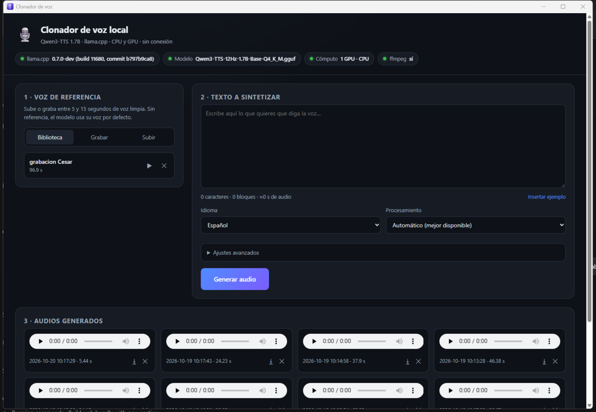

# Clonador de voz — aplicación de escritorio

Aplicación para abrir el **Clonador de voz local (Qwen3-TTS)** con un doble clic,
sin terminal, sin ventana de consola y sin navegador.

- **Abrir:** icono **«Clonador de voz»** del escritorio (o menú Inicio → Clonador de voz → Clonador de voz).
- **Detener:** menú Inicio → Clonador de voz → **Detener clonador de voz**.
- **Registro:** menú Inicio → Clonador de voz → **Ver registro** (por si algo falla).

No se ha modificado ni un archivo del clonador: `app.py`, `static/`, `modelo/` y
`voces/` siguen exactamente igual. Todo lo nuevo vive en esta carpeta `aplicacion/`.

Así se ve la aplicación abierta (ventana propia, con su icono y su nombre en la barra):



---

## Qué hace al pulsar el icono

1. Abre **su propia ventana** al instante (con un rótulo «Arrancando…»).
2. Comprueba si el servidor ya está funcionando en `127.0.0.1` (puertos 8080-8099).
3. Si no lo está, lo arranca **en segundo plano y oculto** con `pythonw.exe`
   (la primera vez tarda unos 5-8 segundos en total).
4. Carga la interfaz dentro de la ventana con **WebView2** (el motor de Edge que ya
   trae Windows): sin pestañas, sin barra de direcciones y sin perfil de navegador aparte.
5. Si la app ya estaba abierta, la trae al frente en vez de abrir otra.

Al cerrar la ventana (`Alt+F4` o la X) el servidor sigue en segundo plano, para que
la próxima apertura sea instantánea. Para apagarlo del todo, usa **Detener**.

---

## Anclar a la barra de tareas (y por qué antes se perdía el icono)

Antes la ventana era una ventana de **Edge en modo aplicación**, así que Windows la
identificaba como «Microsoft Edge» y no tenía icono propio. Al anclar el botón de la
ventana en ejecución, Windows creaba un anclaje genérico de Edge sin icono (y que
además no abría el clonador).

Ahora la ventana es de la propia aplicación (`Clonador de voz.exe`), con su icono
incluido y una identidad registrada (`ClonadorVoz.Local`: nombre «Clonador de voz» e
icono del micrófono). Por eso el anclaje conserva siempre el icono.

**Para dejarlo bien:**

1. Si tienes anclados los botones viejos **«Microsoft Edge»** sin icono: clic derecho
   sobre cada uno → **Desanclar de la barra de tareas**.
2. Abre la app con el icono del escritorio.
3. Clic derecho en su botón de la barra (el del micrófono morado) → **Anclar a la barra de tareas**.
   También vale arrastrar el acceso directo del escritorio a la barra.

---

## Archivos de esta carpeta

| Archivo | Para qué sirve |
|---|---|
| `Clonador de voz.exe` | La aplicación: abre la ventana nativa y arranca el servidor. Es lo que abre el acceso directo. |
| `Clonador de voz.exe.config` | Ajuste de DPI de la ventana (Windows 11 usa escalado 150 %). |
| `fuente\Clonador.cs` | Código fuente de la ventana (se puede recompilar). |
| `Microsoft.Web.WebView2.*.dll`, `WebView2Loader.dll` | SDK de WebView2 que usa la ventana. |
| `lanzador.ps1` | Lógica del servidor: buscarlo, arrancarlo oculto y preparar el `PATH` (ffmpeg). |
| `Lanzar clonador de voz.vbs` | Respaldo: si WebView2 no estuviera disponible, abre la app en Edge. |
| `Detener clonador de voz.vbs` | Cierra la ventana y para el servidor. |
| `detener.ps1` | Lógica de detención (solo para el proceso Python del clonador). |
| `instalar.ps1` | Crea/reinstala los accesos directos del escritorio y del menú Inicio. |
| `Ver registro.vbs` | Abre el registro en el Bloc de notas. |
| `icono.ico` / `icono.png` | Icono de la aplicación (también incrustado en el `.exe`). |
| `_crear_icono.py` | Genera el icono por si quieres cambiar el diseño. |
| `opcional/` | Activar/desactivar que se abra solo al iniciar Windows (no activado). |

---

## Dónde se guardan las cosas

- **Registro:** `%LOCALAPPDATA%\ClonadorVoz\logs\` (`lanzador.log`, `ventana.log`,
  `servidor.out.log`, `servidor.err.log`).
- **Perfil de la ventana (WebView2):** `%LOCALAPPDATA%\ClonadorVoz\webview2`.
- **Puerto en uso:** `%LOCALAPPDATA%\ClonadorVoz\puerto.txt`.
- **Tus voces y audios:** siguen en `..\voces` y `..\salidas`, dentro del proyecto.

---

## Si algo no funciona

1. Abre **Ver registro** y mira la última línea. Los errores también salen en un
   cuadro de diálogo.
2. Comprueba que el puerto está libre. Si el 8080 está ocupado por otra cosa, el
   servidor usa el siguiente (8081…) y la app lo detecta sola.
3. Si el servidor se cerró al arrancar, `servidor.err.log` dirá por qué (por
   ejemplo, falta alguna dependencia de Python).
4. Si has movido la carpeta del proyecto, vuelve a ejecutar `instalar.ps1`: los
   accesos directos guardan la ruta dentro.
5. Si arrancaste el servidor desde una terminal **como administrador**, Windows no
   deja que la app lo pare (verás «Acceso denegado» en **Detener**). Cierra esa
   ventana de terminal: a partir de ahí el servidor lo gestiona la app.
6. Si sale el aviso rojo **«Sin ffmpeg…»**, el servidor en marcha se arrancó con un
   `PATH` antiguo. El lanzador ya lo corrige para los servidores nuevos; para el que
   esté en marcha, pulsa **Detener** y vuelve a abrir el icono.
7. Si en algún momento la ventana se ve en negro (raro, tras minimizar/restaurar),
   ciérrala y vuelve a abrirla.
8. Nota: el puerto 8080 también lo usa **Tailscale** en este equipo. La app solo
   toca el proceso Python del clonador, así que no hay riesgo al usar **Detener**.
9. **Arreglado el 6/11/2026:** desde las actualizaciones de Windows del 29/10
   (`KB5127936`, `KB5132402`) la tabla TCP del sistema devuelve los sockets a la
   escucha **sin estado**. El lanzador filtraba por `-State Listen`, no veía el
   puerto del clonador y a los 75 s concluía «El servidor no respondió», aunque el
   servidor estuviera funcionando. Ahora la detección acepta los sockets sin
   estado (y tiene respaldo por `netstat`, lectura del puerto en el log del
   servidor y 3 minutos de margen). Si vuelve a pasar algo parecido, el
   `lanzador.log` dice «El servidor responde en el puerto X (arranque en N s)».
   Los servidores huérfanos que dejaban los intentos fallidos ya se han cerrado.

Para reinstalar los accesos directos:

```powershell
powershell -ExecutionPolicy Bypass -File "C:\Users\Usuario\Documents\Clonar-voz\aplicacion\instalar.ps1"
```

Para quitarlos (no borra la aplicación):

```powershell
powershell -ExecutionPolicy Bypass -File "C:\Users\Usuario\Documents\Clonar-voz\aplicacion\instalar.ps1" -Quitar
```

---

## Opcional: abrirlo solo al encender el PC

No está activado. Si algún día lo quieres, ejecuta
`opcional\Inicio automatico.bat` (alterna: activar / desactivar).
Crea o elimina un acceso en la carpeta de Inicio de Windows.

---

## Notas técnicas

- Ventana nativa en **.NET Framework 4.8** (viene con Windows) + **WebView2**
  (runtime incluido con Windows 11). No se instala nada nuevo.
- El `.exe` se compiló con `csc` y lleva el icono incrustado; el fuente está en
  `fuente\Clonador.cs` (se compila con `csc /target:winexe /win32icon:icono.ico …`).
- Identidad de app: `SetCurrentProcessExplicitAppUserModelID("ClonadorVoz.Local")`
  más una entrada en `HKCU\Software\Classes\AppUserModelId\ClonadorVoz.Local`
  (nombre, icono y comando para reabrir). Eso es lo que hace que el anclaje
  conserve el icono y el nombre.
- El micrófono se autoriza automáticamente **solo** para `http://127.0.0.1`, para
  que «Grabar» funcione sin diálogos. Los enlaces externos se abren en el navegador.
- Instancia única: si pulsas el icono con la app abierta, se trae al frente.
- El lanzador reconstruye el `PATH` con el del registro de Windows y las rutas
  típicas de Winget/Chocolatey/`C:\ffmpeg\bin` para que el clonador encuentre
  `ffmpeg` aunque se abra desde el escritorio.
- El clonador original (`iniciar.bat`, `iniciar.sh`) sigue disponible como siempre.
